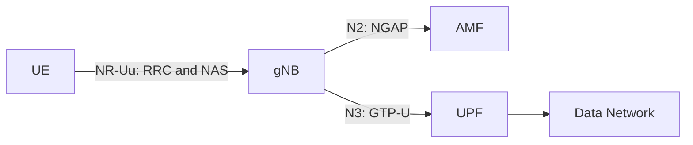

# Lab 1: Analyzing UE–gNB Connectivity in an OAI 5G SA Network

## 1. Lab Overview

In this lab, you will use Wireshark to analyze how a UE establishes an RRC connection with an OAI gNB and then registers with the 5G Core.

The main signaling path is:

```text
UE
→ RRC connection establishment
→ NAS Registration Request
→ gNB forwards the NAS message through NGAP
→ 5G Registration
→ PDU Session establishment
→ UE obtains an IP address
→ User-plane connectivity test
```

This lab focuses on the relationship between the UE and gNB. Internal 5G Core procedures such as detailed SBI and PFCP signaling are outside the main scope.

### Learning objectives

After completing this lab, you should be able to:

1. Identify the UE, gNB, AMF, UPF, and Data Network.
2. Explain the purpose of `RRCSetupRequest`, `RRCSetup`, and `RRCSetupComplete`.
3. Explain how a NAS message is transported from the UE to the AMF through the gNB.
4. Identify the main 5G Registration messages.
5. Verify that the UE receives an IP address and exchanges user-plane traffic.

---

## 2. Required Files

- `OAI-5G-Wireshark-Profile.zip`
- `oai-5g-combined.pcapng`

---

## 3. Install the OAI-5G Wireshark Profile

Profile installed and verified as described in the lab instructions

---

## 4. Open and Verify the Capture

Capture opened with the `OAI-5G` profile selected, and the `nr-rrc` display filter applied to confirm NR RRC decoding.

### Checkpoint 1: Wireshark Setup — 10 points

#### 1.1 Screenshot showing the OAI-5G profile is selected — 3 points


#### 1.2 Screenshot showing the opened capture — 2 points


#### 1.3 Screenshot showing NR RRC packets after applying `nr-rrc` — 5 points


---

## 5. Identify the Basic 5G SA Architecture


*Evidence 1 — NGSetupRequest*


*Evidence 2 — Router Solicitation*


*Evidence 3 — Ping/ICMP traffic*

### Component / IP address table

| Component | IP address | Evidence from the capture |
|---|---|---|
| UE PDU address | 10.0.0.2 | Source Address from ping (Section 5, Evidence 3) |
| gNB | 192.168.70.129 | Source Address from NGSetupRequest (Section 5, Evidence 1) |
| AMF | 192.168.70.132 | Destination Address from NGSetupRequest (Section 5, Evidence 1) |
| UPF | 192.168.70.134 | Destination Address from Router solicitation (Section 5, Evidence 2) |
| Data Network | 192.168.70.135 | Destination Address from ping (Section 5, Evidence 3) |

### Interface table

| Interface | Connected components | Main protocol | Purpose |
|---|---|---|---|
| N1 | UE → AMF | NAS | Handles core control signaling, including network registration, security procedures, and session setup |
| N2 | gNB → AMF | NG-AP | Forwards NAS messages and manages UE contexts as well as PDU sessions between the RAN and the Core |
| N3 | gNB → UPF | GTP-U | Transports actual user data traffic by encapsulating UE IP packets within a tunnel |



### Checkpoint 2: Basic Architecture — 10 points

- Correctly identify the five components and their IP addresses. — 5 points ✔
- Correctly explain N1, N2, and N3. — 5 points ✔

---

## 6. Analyze the RRC Connection Establishment


*RRCSetupRequest — packet 104*


*RRCSetup — packet 105*


*RRCSetupComplete — packet 108*


*Establishment cause — mo-Signalling*


*NAS message carried inside RRCSetupComplete*

### Message table

| Message | Direction | Logical channel / SRB | Main purpose | Packet number |
|---|---|---|---|---:|
| RRCSetupRequest | UE → gNB (Uplink) | UL-CCCH / SRB0 | Request the gNB to establish a connection | 104 |
| RRCSetup | UE ← gNB (Downlink) | DL-CCCH / SRB0 | gNB sets up SRB1 | 105 |
| RRCSetupComplete | UE → gNB (Uplink) | UL-DCCH / SRB1 | Complete the RRC setup and carry the registration request | 108 |

### Answers

**6.1 What is the establishment cause in `RRCSetupRequest`?**
The establishment cause in RRCSetupRequest is mo-Signalling (3) (Section 6, Evidence 4).

**6.2 What SRB does `RRCSetupRequest` use? Why?**
RRCSetupRequest uses SRB0 on UL-CCCH, because it is used before the connection SRB1 is established.

**6.3 Which side sends `RRCSetup`?**
The gNB sends the RRCSetup packet to the UE.

**6.4 Which signaling radio bearer is used after the RRC connection is established?**
After the RRC connection is established, SRB1 is used.

**6.5 Which NAS message is carried inside `RRCSetupComplete`?**
The RRCSetupComplete carries a plain NAS 5GS Message (Section6, Evidence 5).

**6.6 At the end of this procedure, is the UE only connected to the gNB, or is it already registered with the 5G Core? Explain.**
At the end of this procedure, the UE is only connected to the gNB. The end of this procedure does not mean that network registration is complete, and it does not guarantee user-plane data flow.

**6.7 Explain the difference between RRC connection and 5G Registration.**
The RRC connection refers to the creation of a local connection between a radio and a gNB. The 5G registration happens later in the process, when, with the approval of the AMF, the user is completely registered.

### Checkpoint 3: RRC Connection Establishment — 35 points

- Identify all three RRC messages with packet numbers and screenshots. — 12 points ✔
- Correctly identify message directions. — 6 points ✔
- Correctly identify UL-CCCH, DL-CCCH, SRB0, and SRB1 usage. — 7 points ✔
- Explain the purpose of each message. — 6 points ✔
- Explain the difference between RRC connection and 5G Registration. — 4 points ✔

---

## 7. Connect RRC Signaling to NGAP and NAS


*RRCSetupComplete — Registration Request inside dedicatedNAS-Message (packet 108)*


*NGAP InitialUEMessage — Registration Request inside NAS-PDU (packet 110)*

### Mapping table

| Stage | Protocol message | Sender → receiver | Encapsulated information |
|---|---|---|---|
| Radio side | RRCSetupComplete | UE → gNB | dedicatedNAS-Message with the plain NAS 5GS Message |
| Core side | NGAP InitialUEMessage | gNB → AMF | NAS-PDU with the same plain NAS 5GS Message |

### Answers

**7.1 What is the role of the gNB when it transports NAS messages?**
The role of the gNB is to act as an intermediary that receives the NAS message from the UE and forwards it to the AMF. The gNB receives the NAS request inside an RRC message over the radio link and repackages it into an NGAP message to cross the N2 interface.

**7.2 What is the difference between RRC and NAS signaling?**
RRC signaling is used to create and manage the radio connection strictly between the UE and the gNB. NAS signaling operates between the UE and the AMF to handle core network functions like registration and authentication.

**7.3 Is the Registration Request delivered directly from the UE to the AMF? Explain the protocol path.**
The Registration Request is not delivered directly; it is sent as one UE NAS request across two transport messages. The UE sends the Registration Request inside the RRCSetupComplete's dedicatedNAS-Message to the gNB (packet 108). The gNB then forwards this Registration Request inside the NGAP InitialUEMessage's NAS-PDU to the AMF (packet 110).

**7.4 Which message confirms that Registration has completed successfully?**
The Registration Complete message confirms that registration has completed successfully. The AMF first sends a Registration Accept to inform the UE that it is accepted, and the UE then replies with the Registration Complete message to acknowledge completion.

- **Registration Accept:** frame 131
- **Registration Complete:** frame 151

### Checkpoint 4: RRC-to-NGAP/NAS Mapping — 25 points

- Show the Registration Request inside `RRCSetupComplete`. — 6 points ✔
- Show the Registration Request inside NGAP `InitialUEMessage`. — 6 points ✔
- Correctly complete the mapping table. — 5 points ✔
- Explain the roles of RRC, NGAP, NAS, gNB, and AMF. — 5 points ✔
- Identify Registration Accept and Registration Complete. — 3 points ✔

---

## 8. Verify the UE IP Address and User-Plane Traffic
 

*PDU Session Establishment Accept — packet 180*
 

*ICMP Echo Request/Reply exchange — packets 883–886*
 
| Field | Observed value |
|---|---|
| UE IPv4 address | 10.0.0.2 |
 
### Answers
 
**8.1 What IPv4 address was assigned to the UE?**
The IPv4 address 10.0.0.2 is assigned to the UE, as shown in Image 14 (packet 180).
 
**8.2 How many ICMP Echo Request/Reply pairs are present?**
There are 10 ICMP Echo Request/Reply pairs present in the capture, as shown in Image 15.
 
**8.3 What does the successful Echo Reply prove about the UE connection?**
The successful Echo Reply proves that the PDU session is fully established and that the user plane is functional. It demonstrates that the UE can successfully exchange IP packets with the Data Network through the GTP-U tunnel between the gNB and the UPF.
 
### Checkpoint 5: UE IP and User Plane — 15 points
 
- Identify the UE IPv4 address in the PDU Session Establishment Accept. — 6 points ✔
- Show one ICMP Echo Request and its Echo Reply. — 5 points ✔
- Explain what the successful ping proves. — 4 points ✔
---
 
## 9. Final UE Connection Sequence
 

*Sequence diagram — UE, gNB, AMF, UPF, and Data Network, from RRC connection establishment through 5G Registration, PDU Session establishment, and the GTP-U ping test*

### Checkpoint 6: Final Sequence Diagram — 5 points
 
- Include the required components and signaling stages. — 3 points ✔
- Clearly distinguish control-plane and user-plane traffic. — 2 points ✔
---
 
## 10. Submission and Grading
 
| Checkpoint | Topic | Points |
|---:|---|---:|
| 1 | Wireshark profile and NR-RRC decoding | 10 |
| 2 | Basic 5G SA architecture | 10 |
| 3 | RRC connection establishment | 35 |
| 4 | RRC-to-NGAP/NAS mapping | 25 |
| 5 | UE IP and GTP-U user plane | 15 |
| 6 | Final sequence diagram | 5 |
|  | **Total** | **100** |
 