# Lab 2: gNB TDD Traffic Analysis

## 1. Goal

In this lab, you will compare three 5-second UDP iperf3 tests. You will learn how TDD slot allocation can affect downlink and uplink performance.

You do not need to understand every packet. Follow the steps, complete the tables, and answer the short questions.

## 2. Test Scenarios

| Scenario | TDD setting | Traffic direction | Main idea |
|----------|-------------|-------------------|-----------|
| A | DL-heavy | Downlink | The TDD setting favors the traffic direction |
| B | DL-heavy | Uplink | There are fewer opportunities for uplink traffic |
| C | Balanced | Uplink | More uplink opportunities are available than in B |

| Scenario | iperf3 JSON | Wireshark capture |
|----------|-------------|-------------------|
| A | `scenario-a-downlink.json` | `scenario-a-dl-heavy-downlink.pcapng` |
| B | `scenario-b-uplink.json` | `scenario-b-dl-heavy-uplink.pcapng` |
| C | `scenario-c-uplink.json` | `scenario-c-balanced-uplink.pcapng` |

## 3. Task 1 — Confirm the Traffic Direction

- `reverse: 1` means downlink in this lab.
- `reverse: 0` means uplink in this lab.

After opening each JSON file, I found the value at:

```text
start → test_start → reverse
```

This is the data I obtained, shown in the completed table below:

| Scenario | Reverse value | Direction |
|----------|---------------|-----------|
| A | 1 | downlink |
| B | 0 | uplink |
| C | 0 | uplink |

Questions:

1. Does the traffic direction shown in the JSON match the scenario description? Show the evidence.

Yes, the traffic direction shown in the JSON matches the descriptions from the scenarios. See Evidence 1-3


*Evidence 1 — start → test_start → reverse from scenario A*

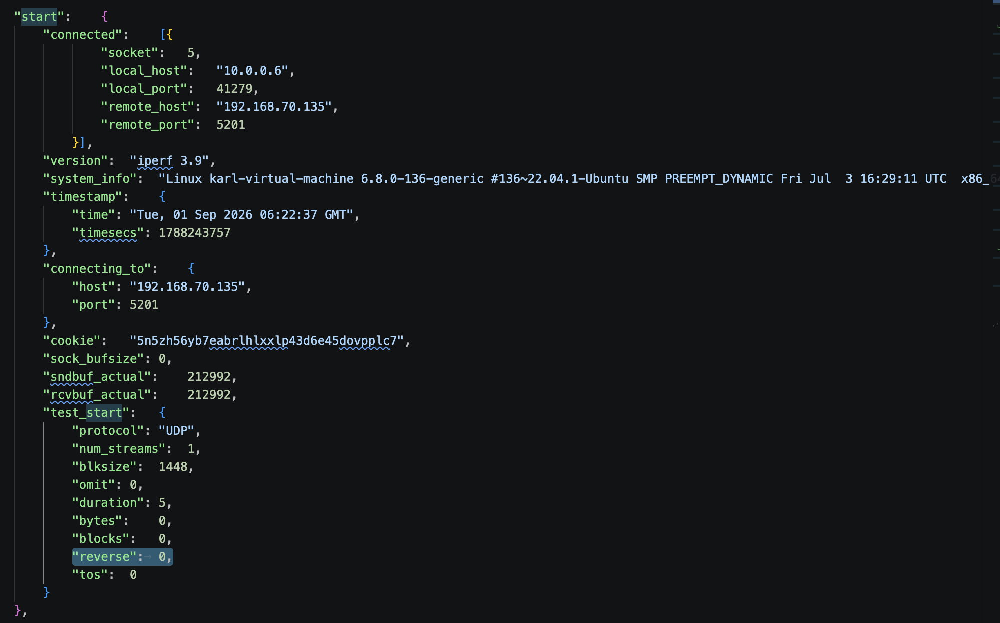
*Evidence 2 — start → test_start → reverse from scenario B*

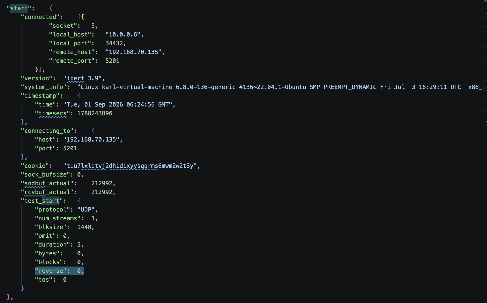
*Evidence 3 — start → test_start → reverse from scenario C*
## 4. Task 2 — Compare Throughput

In each JSON file, I found the bits per second at:

```text
end → sum → bits_per_second
```

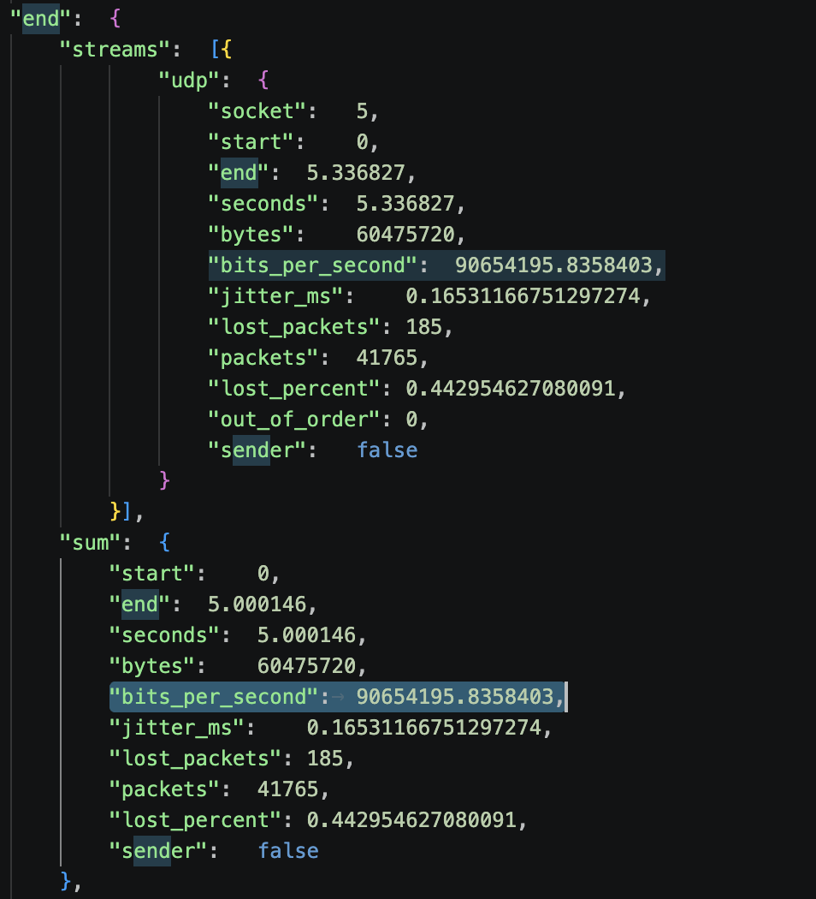
*Evidence 4 — end → sum → bits_per_second from scenario A*

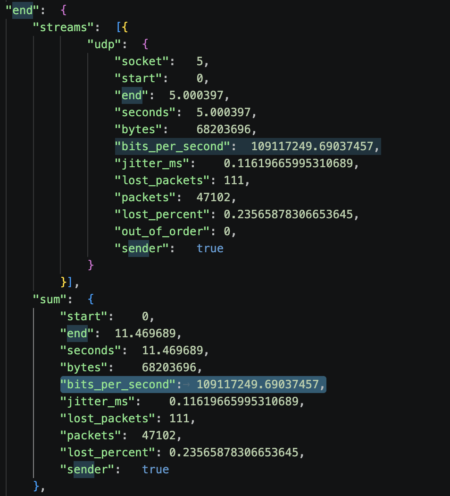
*Evidence 5 — end → sum → bits_per_second from scenario B*

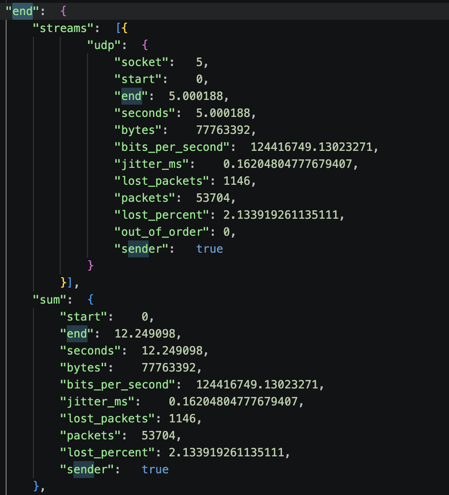
*Evidence 6 — end → sum → bits_per_second from scenario C*

I converted the value to Mbps with this formula:

```text
Throughput (Mbps) = bits_per_second ÷ 1,000,000
```

This is the data I obtained, shown in the completed table below:

| Scenario | Direction | Throughput (Mbps) |
|----------|-----------|-------------------|
| A | Downlink | 90,6541 |
| B | Uplink | 109,1172 |
| C | Uplink | 124,4171 |

I calculated how much C improves over B with this formula:

```text
Improvement (%) = (C - B) ÷ B × 100
```

C improves over B by 14,02 %

Questions:

1. What is the downlink throughput in Scenario A?

    The downlink throughput in scenario A is 90,6541 Mbps.

2. What is the uplink throughput in Scenario B?

    The uplink throughput in scenario B is 109,1172 Mbps.

3. Is the uplink throughput higher in B or C?

    The uplink throughput is higher in scenario C.

4. By approximately what percentage does C improve over B?

    Scenario C has an uplink throughput approximately 14,02% better than Scenario B.

## 5. Task 3 — Check the Trade-off

In each JSON file, I found the lost percent and the jitter (in ms) at:

```text
end → sum → lost_percent
end → sum → jitter_ms
```
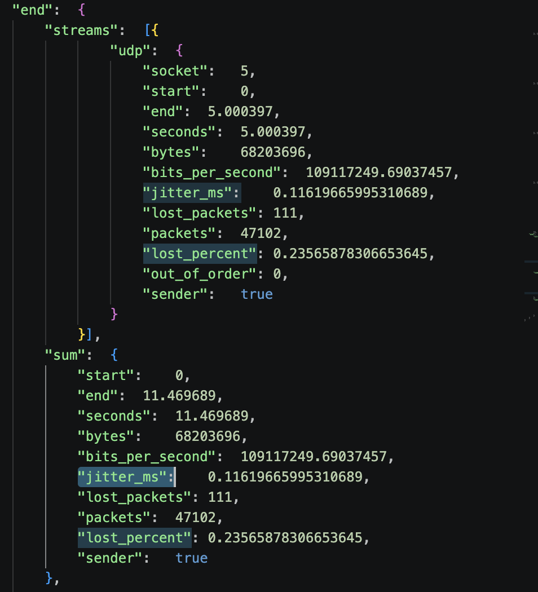
*Evidence 7 — end → sum → lost_percent/jitter_ms from scenario B*

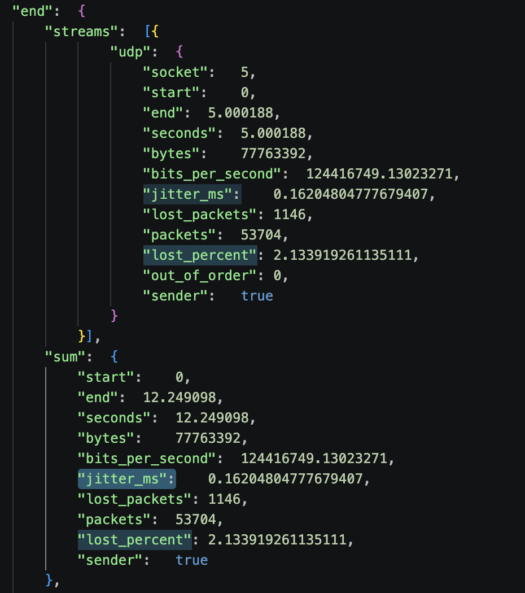
*Evidence 8 — end → sum → lost_percent/jitter_ms from scenario C*

This is the data I obtained, shown in the completed table below:

| Scenario | Throughput (Mbps) | Packet loss (%) | Jitter (ms) |
|----------|-------------------|-----------------|-------------|
| B | 109,1172 | 0,2356 | 0,1161 |
| C | 124,4171 | 2,1339 | 0,1620 |

Questions:

1. Does C have higher uplink throughput than B?

    Yes, Scenario C has a higher uplink throughput than Scenario B (124,4171 Mbps vs 109,1172 Mbps).

2. Does C have lower packet loss than B?

    No, Scenario C has a higher packet loss than Scenario B (2,1339% vs 0,2356%).

3. What is the trade-off when changing from B to C?

    The trade-off is that changing from B to C increases your overall uplink throughput, but significantly increasing packet loss and slightly increasing jitter.

Scenario C has higher throughput, but higher packet loss than Scenario B. Therefore, the balanced TDD setting improves throughput, but it may reduce stability (higher packet loss % and jitter).

## 6. Task 4 — Read SIB1 and Draw the TDD Configuration

Use these **two configuration captures** for this task:

- `tdd-dl-heavy-sib1.pcapng`: Reference configuration for Scenarios A and B.
- `tdd-balanced-sib1.pcapng`: Reference configuration for Scenario C.

These files were recorded separately from the original iperf3 tests. Use them to examine the supplied reference settings.

### 4.1 What Is SIB1?

A gNB broadcasts system information so that a UE can learn how to access the cell.

- **MIB (Master Information Block):** Provides basic information, including parameters needed to find SIB1.
- **SIB1 (System Information Block Type 1):** Provides cell-access and common radio configuration information. In this TDD lab, it includes `tdd-UL-DL-ConfigurationCommon`.

You will read the **common TDD configuration in SIB1**, not decode every MIB/SIB field. This configuration describes DL, UL, and flexible time resources; it is not a record of the actual data scheduled in every slot.

### 4.2 Enable MAC-NR Decoding and Find SIB1

These captures contain NR MAC messages carried over UDP. **Enable MAC-NR-over-UDP decoding before applying the SIB1 filter.** Without this decoder, the packets may appear only as UDP and the SIB1 filter may return no results.

1. Open `tdd-dl-heavy-sib1.pcapng` in Wireshark.
2. Open **Analyze → Enabled Protocols**. Locate **MAC-NR over UDP** (`mac_nr_udp`) in the heuristic dissectors list and enable it. Depending on the Wireshark version, the heuristic list may be shown separately. Apply the change and reload the capture if needed.
3. Apply this display filter:

   ```text
   nr-rrc.systemInformationBlockType1_element
   ```

4. Select a SIB1 packet. In the packet details, expand:

   ```text
   NR Radio Resource Control (RRC) protocol
     → BCCH-DL-SCH-Message
       → message
         → c1
           → systemInformationBlockType1
             → servingCellConfigCommon
               → tdd-UL-DL-ConfigurationCommon
   ```

5. Read `referenceSubcarrierSpacing`, then expand `pattern1` and record:

   ```text
   dl-UL-TransmissionPeriodicity
   nrofDownlinkSlots
   nrofDownlinkSymbols
   nrofUplinkSlots
   nrofUplinkSymbols
   ```

6. Check whether `pattern2` is also present.
7. Repeat for `tdd-balanced-sib1.pcapng`.

Record the **decoded labels and units** shown in Wireshark. For example, record `30 kHz` or `5 ms`, not the enumeration number displayed in parentheses.

You can also locate packets containing the TDD configuration with:

```text
nr-rrc.tdd_UL_DL_ConfigurationCommon_element
```

Confirm that the selected TDD fields are inside **SIB1**. If a filter is not recognized in your version, try `nr-rrc` and locate `systemInformationBlockType1` manually.

> **Troubleshooting:** If packets still appear only as UDP, check that the **MAC-NR over UDP heuristic dissector** is enabled, rather than only the MAC-NR protocol. If the file still does not decode, ask the instructor to check the settings. Do not infer TDD parameters from packet timing. Graphical menu labels may vary by version.

### 4.3 Record the TDD Parameters

Complete the table for `pattern1`:

| Item | DL-heavy: A/B | Balanced: C |
| --- | --- | --- |
| Configuration capture filename | | |
| SIB1 packet number | | |
| `referenceSubcarrierSpacing` (kHz) | | |
| `dl-UL-TransmissionPeriodicity` (ms) | | |
| `nrofDownlinkSlots` | | |
| `nrofDownlinkSymbols` | | |
| `nrofUplinkSlots` | | |
| `nrofUplinkSymbols` | | |
| Is `pattern2` present? | | |

If `pattern2` is present, add another table containing its period and four slot/symbol counts. It uses the same reference SCS.

Take **one screenshot per configuration** showing the selected SIB1 packet and the expanded TDD fields. Include `pattern2` in an additional screenshot if it is present and does not fit.

### 4.4 Draw the TDD Time Allocation

Draw one diagram for DL-heavy and one for balanced. **Use the same 0–5 ms time axis for both diagrams.** Derive each repeating period from SIB1 and repeat the shorter pattern as needed to fill the 5 ms interval. Mark every repeating-period boundary.

A spreadsheet, a drawing tool, or a hand-drawn diagram is acceptable. Include the diagrams as images in your report.

For the normal cyclic prefix used in this exercise, each reference slot contains **14 OFDM symbols**, numbered **0–13**. Use the SIB1 **reference SCS** to construct the common pattern:

| Reference SCS | Reference slot duration |
| --- | ---: |
| 15 kHz | 1 ms |
| 30 kHz | 0.5 ms |
| 60 kHz | 0.25 ms |
| 120 kHz | 0.125 ms |

```text
Number of reference slots in a pattern = Pattern period ÷ Reference slot duration
```

For each pattern:

1. Place `nrofDownlinkSlots` full DL slots at the beginning.
2. If `nrofDownlinkSymbols` is nonzero, mark that many symbols at the beginning of the next slot as DL.
3. Place `nrofUplinkSlots` full UL slots at the end.
4. If `nrofUplinkSymbols` is nonzero, mark that many symbols at the end of the slot immediately before the full UL slots as UL. If there are no full UL slots, use the last slot of the pattern.
5. Mark all remaining symbols as **F (flexible)**. The partial DL and partial UL portions may be in the same slot or in different slots.

Use **D = downlink**, **U = uplink**, and **F = flexible**. Include a legend, the common 0–5 ms time scale, slot indices, and repeating-period boundaries. You may restart the local slot index at zero at each period boundary, but label the boundaries clearly. Expand any mixed slot to show all 14 symbols. Do not automatically label flexible symbols as UL or guard time.

If `pattern2` is present, draw `pattern1` followed by `pattern2`; the combined sequence repeats. Label each pattern boundary and show the full combined duration.

First, count the symbols over **one complete repeating sequence** for each configuration. The two sequences may have different durations, so their raw UL symbol counts alone cannot be used to compare resources per unit time:

```text
Configured DL symbols = 14 × Full DL slots + Partial DL symbols
Configured UL symbols = 14 × Full UL slots + Partial UL symbols
Flexible symbols = Total symbols - Configured DL symbols - Configured UL symbols
Configured UL symbol share (%) = Configured UL symbols ÷ Total symbols × 100
```

For two patterns, sum the counts and durations of both patterns before calculating the share. These are symbol-count shares of the common configuration, not exact airtime measurements or measured throughput shares.

| TDD setting | Repeating duration (ms) | Total reference slots | DL symbols | UL symbols | Flexible symbols | Configured UL symbol share (%) |
| --- | ---: | ---: | ---: | ---: | ---: | ---: |
| DL-heavy | | | | | | |
| Balanced | | | | | | |

Next, count the symbols over the **same 5 ms interval** shown in your diagrams. Multiply each per-sequence count by the number of complete repetitions in 5 ms. For these captures, 5 ms contains a whole number of repetitions for both configurations.

| TDD setting | Repeating duration (ms) | Repetitions in 5 ms | DL symbols in 5 ms | UL symbols in 5 ms | Flexible symbols in 5 ms |
| --- | ---: | ---: | ---: | ---: | ---: |
| DL-heavy | | | | | |
| Balanced | | | | | |

**Question:** Can two patterns have the same UL symbol count per period but provide different numbers of UL symbols per unit time? Explain using your two tables.

### 4.5 Connect SIB1 to the Performance Results

Use the supplied mapping between the reference configuration captures and scenarios. Complete this table using Tasks 1–3 and your SIB1 analysis:

| Scenario | Reference TDD setting | JSON traffic direction | Configured UL symbol share (%) | Throughput (Mbps) | Packet loss (%) |
| --- | --- | --- | ---: | ---: | ---: |
| A | DL-heavy | | | | |
| B | DL-heavy | | | | |
| C | Balanced | | | | |

Answer:

1. Which decoded TDD parameters differ between DL-heavy and balanced?
2. Which configuration provides more configured UL symbols per unit time? Support your answer with the diagram and calculated share.
3. How does that difference help explain the B/C throughput comparison?
4. Why can A and B use the same SIB1 TDD configuration even though their traffic directions differ?

> More configured UL resources can provide more opportunities for uplink traffic, but they do not guarantee a proportional throughput increase. Scheduling, radio conditions, overhead, offered traffic, and other radio settings also affect the result. This comparison does not establish that the TDD pattern is the only cause of a performance difference. SIB1 does not show actual slot-by-slot data scheduling. Because the configuration captures were recorded separately, use them as references for the supplied settings, not as independent proof of what was broadcast during each original performance run.


## 7. Task 5 — Is the TDD Setting Suitable?

Completed table, based on the scenario descriptions and my throughput results:

| Scenario | TDD setting | Traffic direction | Do they match? |
|----------|-------------|-------------------|----------------|
| A | DL-heavy | Downlink | Yes (A DL-heavy setting is suitable for downlink traffic). |
| B | DL-heavy | Uplink | No (A DL-heavy setting may limit heavy uplink traffic). |
| C | Balanced | Uplink | Yes (A balanced setting gives uplink traffic more opportunities). |

Question:

1. Why might Scenario C achieve better uplink throughput than Scenario B?

Scenario C might achieve better uplink throughput than scenario B, because of the TDD setting that is used in those scenario. Scenario C used Balanced setting, that lead in more traffic opportunities 

## 8. Task 6 — Find GTP-U Information

After opening a `.pcapng` file in Wireshark, I entered this display filter:

```text
gtp && ip
```
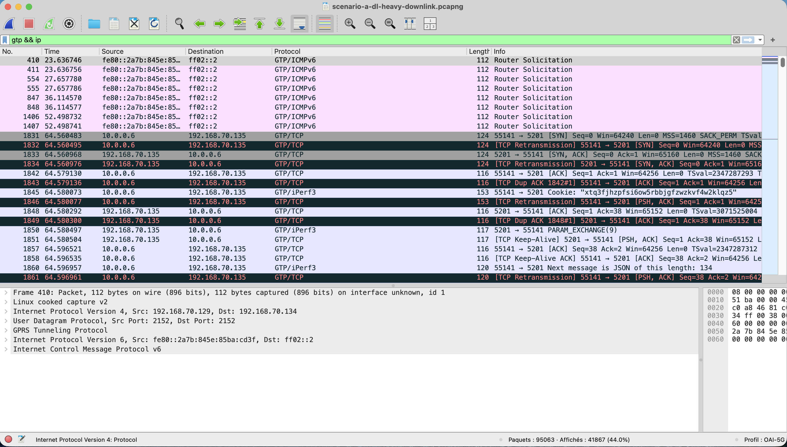
*Evidence 9 — .pcapng from scenario A*

I chose a packet that contains two IPv4 headers. In the packet details, I expanded:

1. the first `Internet Protocol Version 4` header;
2. `User Datagram Protocol`;
3. `GPRS Tunneling Protocol`; and
4. the second `Internet Protocol Version 4` header.

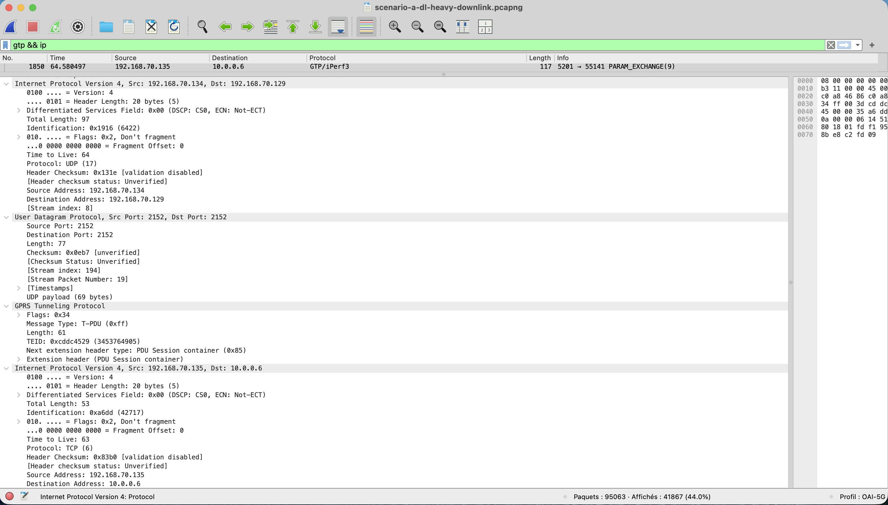
*Evidence 10 — Packet 1850 with all of the packets details from above expanded*

I recorded the following information from this packet:

| Item | Value |
|------|-------|
| Packet number | 1850 |
| Outer source IP | 192.168.70.134 |
| Outer destination IP | 192.168.70.129 |
| Inner source IP | 192.168.70.135 |
| Inner destination IP | 10.0.0.6 |
| TEID | 0xcddc4529 (3453764905) |

## 9. Task 7 — TCP Retransmissions

The performance traffic is UDP, but iperf3 also uses a small TCP control connection.

After applying this Wireshark filter:

```text
tcp.analysis.retransmission
```

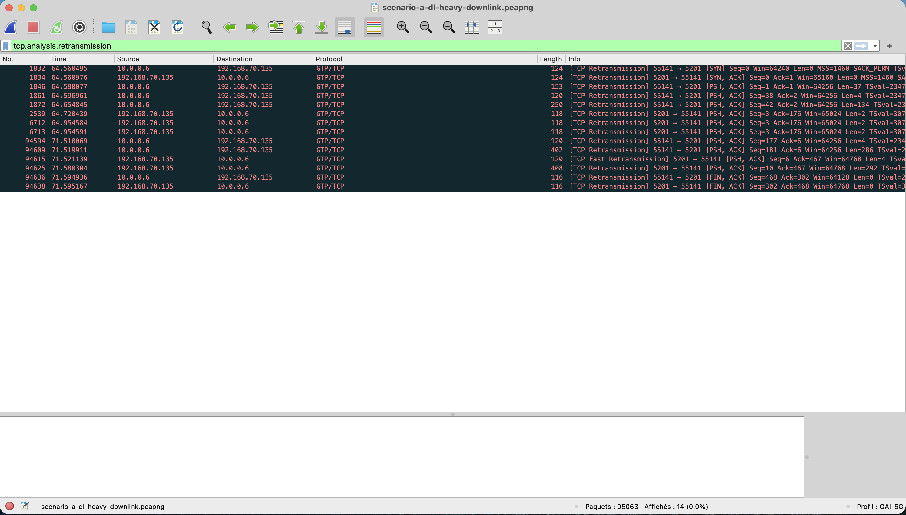
*Evidence 11 — Displayed packets from scenario A*

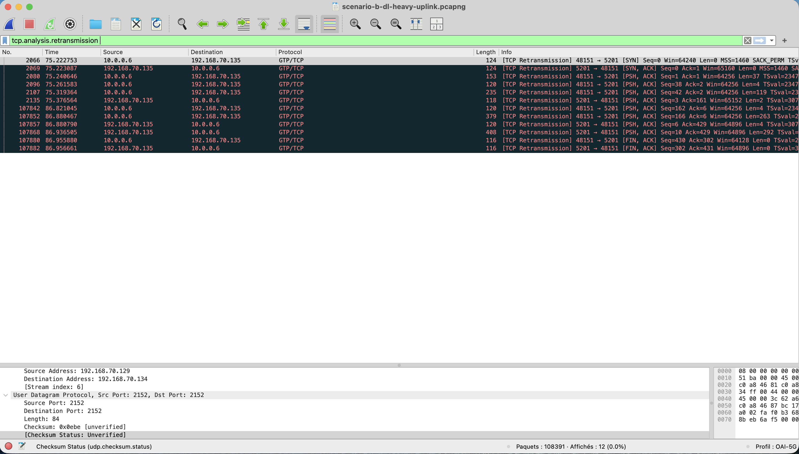
*Evidence 12 — Displayed packets from scenario B*

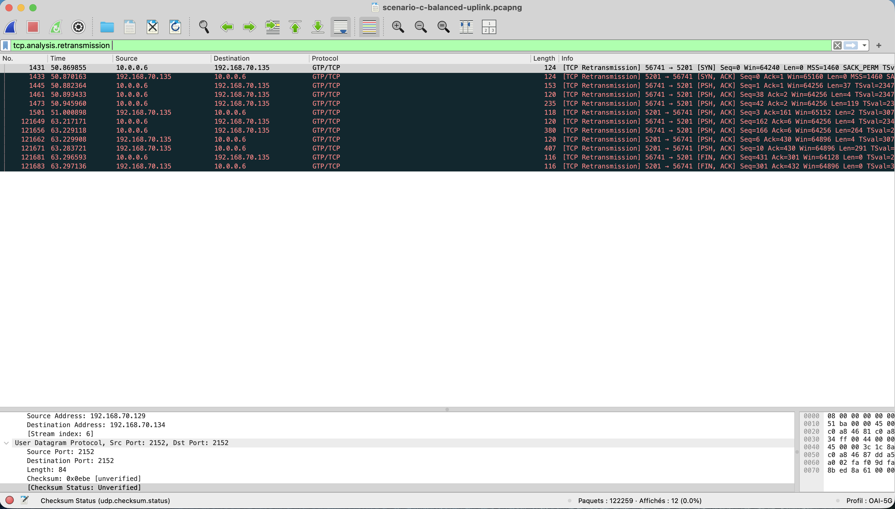
*Evidence 13 — Displayed packets from scenario C*

I recorded the number of displayed packets:

| Scenario | Displayed TCP retransmissions |
|----------|-------------------------------|
| A | 14 |
| B | 12 |
| C | 12 |

Question:

1. Do these TCP retransmissions directly represent lost UDP performance packets?

No, these TCP retransmissions do not directly represent lost UDP performance packets. The loss of TCP packets is due to the TCP control connection and not UDP directly. The throughput test uses UDP, and the capture shown in Wireshark could contain duplicates, so the number of displayed packets is not a direct representation.


## 10. Task 8 — RTT and Packet Interval

### TCP RTT

I applied this filter to the .pcapng of scenario A:

```text
tcp.analysis.ack_rtt
```
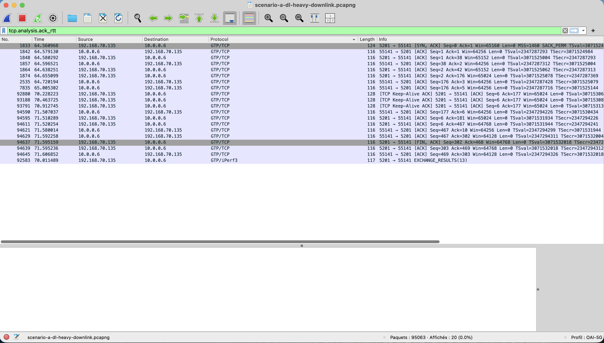
*Evidence 14 — .pcapng from scenario A*

I selected one packet and recorded its ACK RTT:


*Evidence 15 — .pcapng from scenario A, seq 1 is transmitted at 64.560968 and received at 64.579130*

| Scenario | Example TCP ACK RTT |
|----------|---------------------|
| A | 0.018162 (18.162000 milliseconds)|

This value is the RTT of the TCP control connection. It is not the RTT of the UDP data packets.

### Packet interval

I selected two nearby packets from the same flow. In the packet details, I found:

```text
Time delta from previous displayed frame
```

One example:

| Flow | Packet numbers | Time interval |
|------|----------------|---------------|
| TCP | 1842 & 1843 | 6.000 microseconds |
| TCP | 1843 & 1846| 4.000 microseconds |

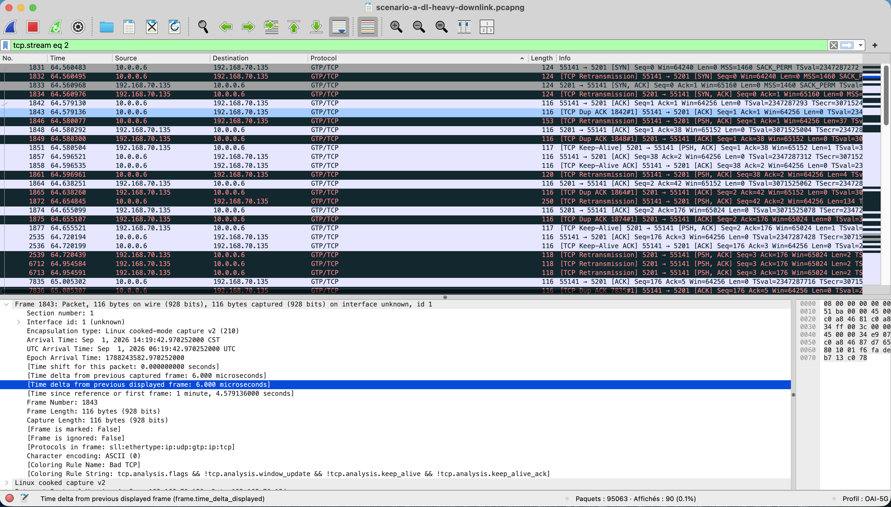
*Evidence 16 — Time delta from previous displayed frame for frame 1843*

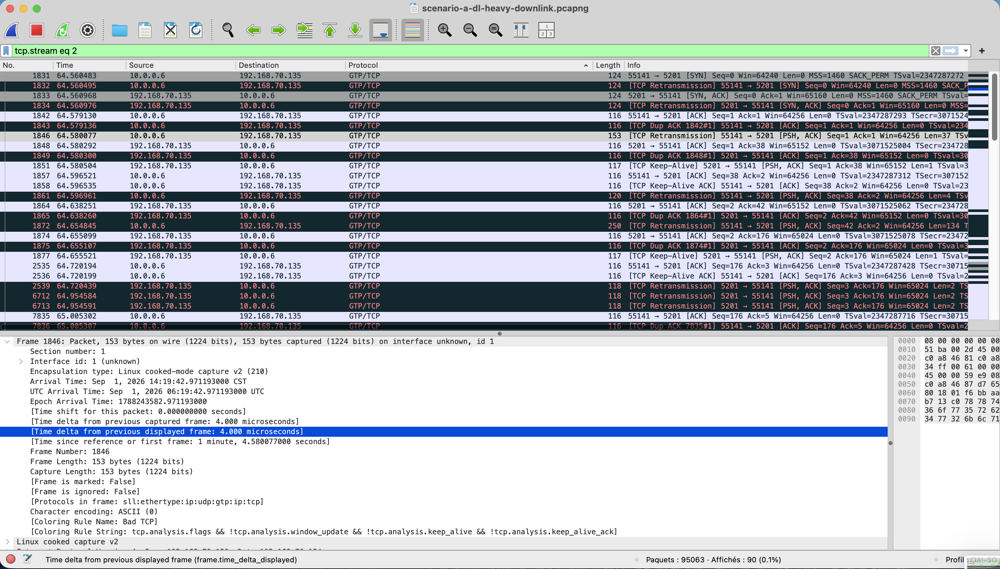
*Evidence 17 — Time delta from previous displayed frame for frame 1846*

Packet interval means the time between two packets seen at the capture point. It is not the same as RTT.

## 11. Final Questions

1. Does Scenario A use a TDD setting that matches its traffic direction?
2. Why is Scenario B expected to have limited uplink resources?
3. How much does uplink throughput change from B to C?
4. What negative result is visible in C?
5. Why can increasing UL slots improve uplink throughput?
6. Is adding more UL slots always the best solution? Explain using throughput and packet loss.
7. Suggest one simple follow-up test that could improve throughput without producing too much packet loss.

## 12. Submission Checklist

Submit one Markdown file containing:

- the completed direction table;
- the throughput table and B-to-C calculation;
- the B/C packet-loss and jitter table;
- the SIB1 TDD parameter table, including filenames and packet numbers;
- one SIB1 TDD screenshot per configuration, plus `pattern2` screenshots if needed;
- two TDD diagrams: DL-heavy and balanced, with D/U/F labels and mixed-slot symbol details;
- the per-sequence symbol-count / UL-share table, the common 5 ms comparison table, and the configuration-to-performance table;
- the Task 4.5 answers and the TDD suitability table;
- one GTP-U screenshot and its completed table;
- the TCP retransmission counts and screenshots;
- one TCP ACK RTT example;
- one packet-interval example; and
- answers to the final questions.

The PRACH observation is optional and carries no required points. Include all referenced image files alongside the Markdown file, or submit a ZIP containing the report and images.

## 13. Grading Rubric

| Item | Points |
| --- | ---: |
| Traffic direction | 5 |
| Throughput values and calculation | 20 |
| B/C packet-loss and jitter comparison | 15 |
| SIB1 TDD parameter extraction and screenshot evidence | 10 |
| TDD diagrams, symbol counts, and UL shares | 10 |
| TDD suitability and connection to measured performance | 10 |
| GTP-U fields and screenshot | 15 |
| TCP retransmission, RTT, and packet interval | 10 |
| Clear final answers | 5 |
| **Total** | **100** |

## References

These references support the field names and interpretation. Reading the full specifications is not required.

- [Wireshark NR RRC display filter reference](https://www.wireshark.org/docs/dfref/n/nr-rrc.html): SIB1 and TDD display-filter fields.
- [3GPP TS 38.331, Release 18](https://www.etsi.org/deliver/etsi_ts/138300_138399/138331/18.08.00_60/ts_138331v180800p.pdf): SIB1, TDD-UL-DL-ConfigCommon, and TDD-UL-DL-Pattern definitions.
- [3GPP TS 38.213, Release 17, Section 11.1](https://www.etsi.org/deliver/etsi_ts/138200_138299/138213/17.06.00_60/ts_138213v170600p.pdf): Interpretation of common TDD slot and symbol allocation.