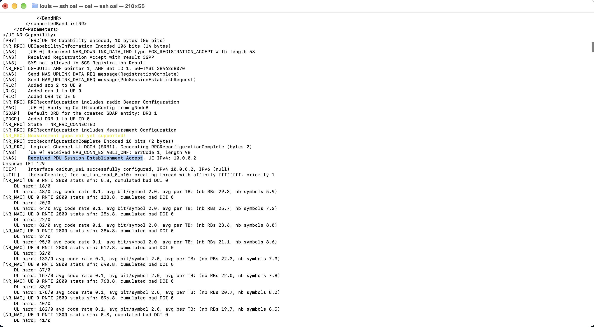
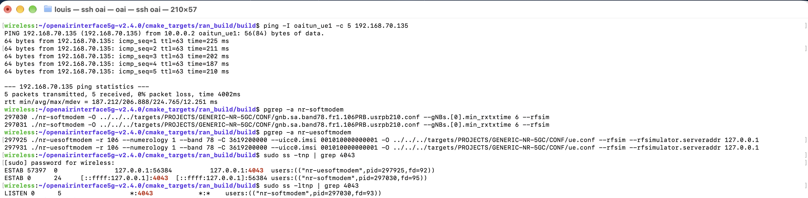

# Lab 3: Deploying a 5G Standalone Network Using OpenAirInterface

## 1. Goal

In the previous labs, you analyzed 5G signaling messages and network performance using provided captures and measurements.

In this lab, you will deploy your own 5G Standalone (SA) network using OpenAirInterface (OAI), verify the complete connection, investigate RFsimulator communication, perform active network measurements, and troubleshoot a controlled connection failure.

Unlike the previous labs, you will collect measurements directly from your own running 5G network.

**Learning Objectives**

After completing this lab, you should be able to:

1. Deploy an OAI gNB, nrUE, and 5G Core Network.
2. Identify the main stages of 5G SA connection establishment.
3. Verify communication between gNB and nrUE through RFsimulator.
4. Measure user-plane connectivity under different packet sizes.
5. Diagnose connection failures using OAI and 5GC logs.
6. Explain the limitations of a software-simulated 5G network.

## 2. Experimental Environment

Use the *OAI v2.4.0 Build Guide* to prepare the environment before class.

| Component | Configuration |
|---|---|
| Ubuntu | 24.04 |
| OAI RAN | v2.4.0 |
| 5G Core | OAI CN5G |
| gNB | nr-softmodem |
| UE | nr-uesoftmodem |
| Radio interface | RFsimulator |
| Band | n78 |
| Subcarrier spacing | 30 kHz |
| Resource blocks | 106 |
| UE IMSI | 001010000000001 |
| External DN | 192.168.70.135 |

The experiment uses one Ubuntu machine without physical RF hardware.

## 3. Task 1 — Deploy and Verify the Complete 5G SA Network

Start the OAI CN5G:

```bash
cd ~/oai-cn5g
docker compose up -d
docker compose ps
```

Start the gNB and nrUE using the commands in the Build Guide.

Observe their terminal outputs and locate evidence of the following stages.

| Stage | Successful? | Evidence from logs |
|---|---|---|
| CN5G initialization |  | |
| gNB NG Setup | | |
| UE synchronization | | |
| RRC connection establishment | | |
| UE Registration | | |
| PDU Session Establishment | | |
| UE tunnel creation | | |

Take screenshots showing the gNB and UE successfully connected.


*Evidence 1 — screenshot of gNB successfully connected*


*Evidence 2 — screenshot of UE successfully connected*

**Questions:**

1. Does a successful NG Setup guarantee that a UE can register? Explain.
2. Why can the UE establish an RRC connection but still fail Registration?
3. What additional procedure is required after Registration before user data can be exchanged?

## 4. Task 2 — Investigate RFsimulator Communication

OAI RFsimulator replaces the physical RF interface with software-based communication.

The gNB and nrUE exchange IQ samples through a TCP connection.

Check the running processes:

```bash
pgrep -a nr-softmodem
pgrep -a nr-uesoftmodem
```

Inspect the TCP connections:

```bash
sudo ss -tnp | grep 4043
```

If necessary, inspect the listener:

```bash
sudo ss -ltnp | grep 4043
```

The default RFsimulator port in this experiment is 4043.

Complete the table:

| Item | Observed Value |
|---|---|
| gNB process ID | |
| nrUE process ID | |
| RFsimulator transport protocol | |
| RFsimulator port | |
| TCP connection state | |
| Connected process(es) | |

Take one screenshot showing the TCP connection.

**Questions:**

1. Why does RFsimulator use a TCP connection instead of a physical antenna?
2. Are the TCP packets exchanged by RFsimulator the same as the UE's application-layer IP packets?
3. Does using RFsimulator mean that the UE and gNB are performing no physical-layer processing? Explain.

## 5. Task 3 — Verify End-to-End Connectivity

Check the UE tunnel interface:

```bash
ip -4 addr show oaitun_ue1
```

Test connectivity to the External DN:

```bash
ping -I oaitun_ue1 -c 10 192.168.70.135
```

Record:

| Measurement | Observed Value |
|---|---|
| UE IP address | |
| Destination IP | |
| Packets transmitted | |
| Packets received | |
| Packet loss (%) | |
| Minimum RTT (ms) | |
| Average RTT (ms) | |
| Maximum RTT (ms) | |

Take a screenshot of the Ping result.

**Questions:**

1. Why must Ping use the `oaitun_ue1` interface in this experiment?
2. Does successful Registration guarantee successful user-plane connectivity?
3. What does a successful Ping prove, and what does it not prove about the simulated 5G system?

## 6. Task 4 — Investigate the Effect of Packet Size

You will now investigate whether changing the ICMP packet size affects the observed RTT.

Perform three experiments using the same established 5G connection.

**Scenario A — Small Packets**

```bash
ping -I oaitun_ue1 -s 56 -c 30 -i 0.2 192.168.70.135
```

**Scenario B — Medium Packets**

```bash
ping -I oaitun_ue1 -s 512 -c 30 -i 0.2 192.168.70.135
```

**Scenario C — Large Packets**

```bash
ping -I oaitun_ue1 -s 1200 -c 30 -i 0.2 192.168.70.135
```

Note: `-s` specifies ICMP payload size, not the complete IP packet size.

Complete the table:

| Scenario | ICMP Payload | Avg. RTT (ms) | Max. RTT (ms) | Packet Loss (%) |
|---|---:|---:|---:|---:|
| A | 56 bytes | | | |
| B | 512 bytes | | | |
| C | 1200 bytes | | | |

Calculate the RTT difference:

```text
RTT Difference = Average RTT(C) - Average RTT(A)
```

**Questions:**

1. Which scenario has the highest average RTT?
2. Does increasing packet size always increase RTT in your measurements?
3. Why might a larger packet require more transmission or processing resources?
4. What factors other than packet size could affect RTT in a software-based 5G network?
5. Can these results be interpreted as real over-the-air 5G latency? Explain.

Do not assume that RTT must increase with packet size. Use your measured values to support your explanation.

## 7. Task 5 — Diagnose a Controlled UE Registration Failure

In this task, you will deliberately introduce one configuration error and investigate why the UE cannot complete registration.

**Important:** Save the original successful UE command before starting. Do not modify the CN5G subscriber database.

### Step 1 — Stop the UE

Press `Ctrl+C` in the nrUE terminal. Keep the CN5G and gNB running.

### Step 2 — Launch the UE with an Incorrect IMSI

Change only the IMSI:

```bash
sudo ./nr-uesoftmodem \
  -r 106 \
  --numerology 1 \
  --band 78 \
  -C 3619200000 \
  --uicc0.imsi 001010000000099 \
  --rfsim \
  --rfsimulator.serveraddr 127.0.0.1
```

The IMSI `001010000000099` is not provisioned in the standard classroom subscriber configuration. Verify this assumption against the instructor's database before class.

Observe the UE and AMF logs.

```bash
cd ~/oai-cn5g
docker compose logs --since=2m oai-amf
```

Allow time for registration attempts, then stop the UE.

Complete the table:

| Item | Observation |
|---|---|
| Modified parameter | |
| UE synchronized with gNB? | |
| RRC connection established? | |
| Registration successful? | |
| Error or rejection evidence | |
| Likely cause | |

If the expected registration rejection does not appear, report the actual logs instead of inventing a failure message.

### Step 3 — Restore the Original IMSI

Restart the nrUE using:

```text
--uicc0.imsi 001010000000001
```

Confirm that the UE successfully registers again and that Ping works.

**Questions:**

1. Why can the UE potentially synchronize with the gNB even when the IMSI is incorrect?
2. Which network function is involved in UE authentication?
3. Why does changing an IMSI affect Registration but not the RFsimulator TCP connection itself?
4. What evidence proves that restoring the correct configuration solved the problem?

Submit evidence from both the failed and recovered connections.


## 8. Task 7 — Explain the Relationship Between Simulation and Real 5G

Your OAI gNB and nrUE perform 5G NR protocol processing even though they do not use physical antennas.

Complete the comparison:

| Feature | OAI RFsimulator | Physical 5G System |
|---|---|---|
| gNB and UE protocol stack | | |
| OFDM signal processing | | |
| Physical antennas | | |
| RF hardware impairments | | |
| Wireless propagation effects | | |
| 5G Core connectivity | | |

**Questions:**

1. Which parts of the 5G system remain functional when physical RF hardware is replaced with RFsimulator?
2. Why is RFsimulator useful for testing the 5G protocol stack?
3. Why might latency and throughput differ between RFsimulator and a real 5G deployment?
4. What would need to change if you wanted to test a physical UE instead of OAI nrUE?

## 9. Final Analysis

Answer each question in three to five sentences.

1. Describe the complete process from starting the OAI 5GC to successful user-plane connectivity.
2. Explain the difference between an RFsimulator TCP connection and a 5G PDU Session.
3. Based on your measurements, how did packet size affect RTT and packet loss?
4. Describe the registration failure you introduced and explain how you diagnosed and recovered from it.
5. Identify two limitations of this simulated environment and explain how they might affect experimental results.

## 10. Submission Checklist

Submit one Markdown or PDF report containing:

- Completed 5G SA connection verification table.
- gNB and nrUE connection screenshots.
- RFsimulator TCP connection evidence.
- Baseline Ping measurement.
- Three packet-size comparison results.
- RTT difference calculation.
- Controlled failure and recovery evidence.
- RFsimulator versus physical 5G comparison.
- Answers to the final analysis questions.

All measurements and log evidence must come from your own experimental environment.

## 11. Grading Rubric

| Item | Points |
|---|---:|
| Complete 5G SA deployment | 15 |
| RFsimulator TCP connection analysis | 15 |
| End-to-end user-plane verification | 15 |
| Packet-size experiment and analysis | 20 |
| Controlled failure and recovery | 20 |
| Simulation limitations and final analysis | 15 |
| **Total** | **100** |

Vote TOP3：https://forms.gle/Mvza68DFBzPcZXfW6