# Lab 3: Deploying a 5G Standalone Network Using OpenAirInterface

## 1. Goal

In the previous labs, you analyzed 5G signaling messages and network performance using provided captures and measurements.

In this lab, you will deploy your own 5G Standalone (SA) network using OpenAirInterface (OAI), verify the complete connection, investigate RFsimulator communication, perform active network measurements, and troubleshoot a controlled connection failure.

Unlike the previous labs, you will collect measurements directly from your own running 5G network.

**Learning Objectives**

After completing this lab, you should be able to:

1. Deploy an OAI gNB, nrUE, and 5G Core Network.
2. Identify the main stages of 5G SA connection establishment.
3. Verify communication between gNB and nrUE through RFsimulator.
4. Measure user-plane connectivity under different packet sizes.
5. Diagnose connection failures using OAI and 5GC logs.
6. Explain the limitations of a software-simulated 5G network.

## 2. Experimental Environment

Use the *OAI v2.4.0 Build Guide* to prepare the environment before class.

| Component | Configuration |
|---|---|
| Ubuntu | 24.04 |
| OAI RAN | v2.4.0 |
| 5G Core | OAI CN5G |
| gNB | nr-softmodem |
| UE | nr-uesoftmodem |
| Radio interface | RFsimulator |
| Band | n78 |
| Subcarrier spacing | 30 kHz |
| Resource blocks | 106 |
| UE IMSI | 001010000000001 |
| External DN | 192.168.70.135 |

The experiment uses one Ubuntu machine without physical RF hardware.

## 3. Task 1 — Deploy and Verify the Complete 5G SA Network

Start the OAI CN5G:

```bash
cd ~/oai-cn5g
docker compose up -d
docker compose ps
```

Start the gNB and nrUE using the commands in the Build Guide.

Observe their terminal outputs and locate evidence of the following stages.

| Stage | Successful? | Evidence from logs |
|---|---|---|
| CN5G initialization | Yes | 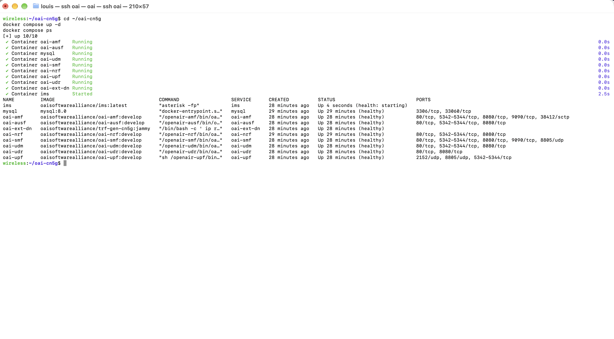*docker compose ps: containers healthy*|
| gNB NG Setup | Yes | 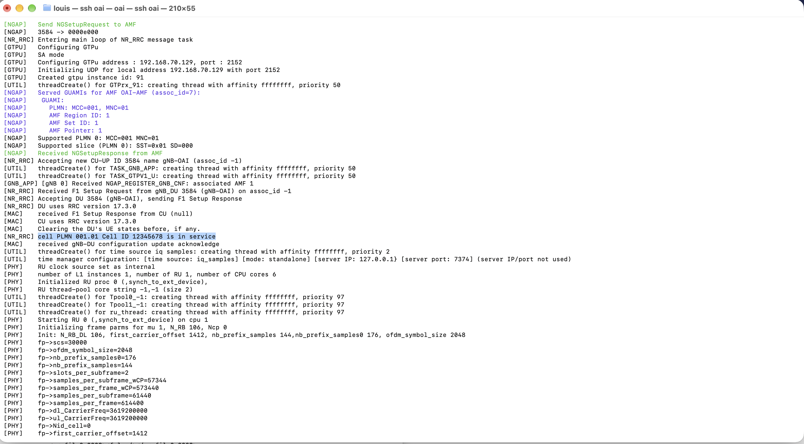*Send NGSetupRequest to AMF, Received NGSetupResponse from AMF, cell PLMN 001.01 Cell ID 12345678 is in service* |
| UE synchronization | Yes  |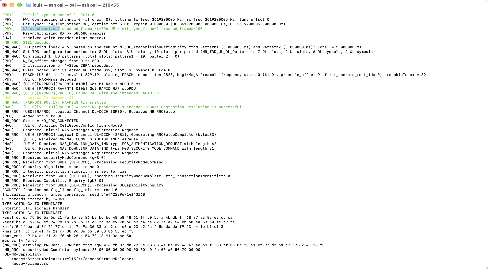 *Initial sync successful, PCI: 0, UE synchronized!* |
| RRC connection establishment | Yes | 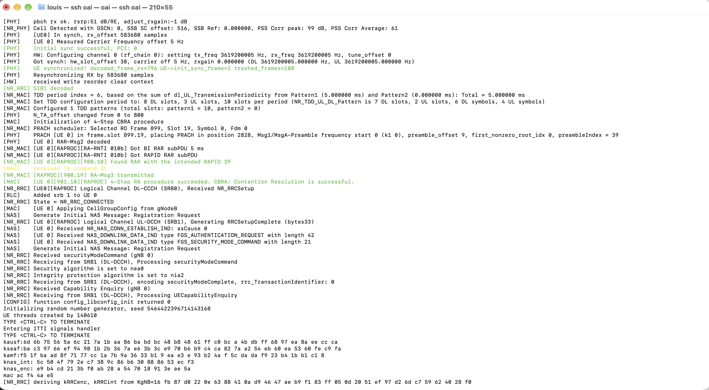 *4-Step RA procedure succeeded, State = NR_RRC_CONNECTED*|
| UE Registration |  Yes | 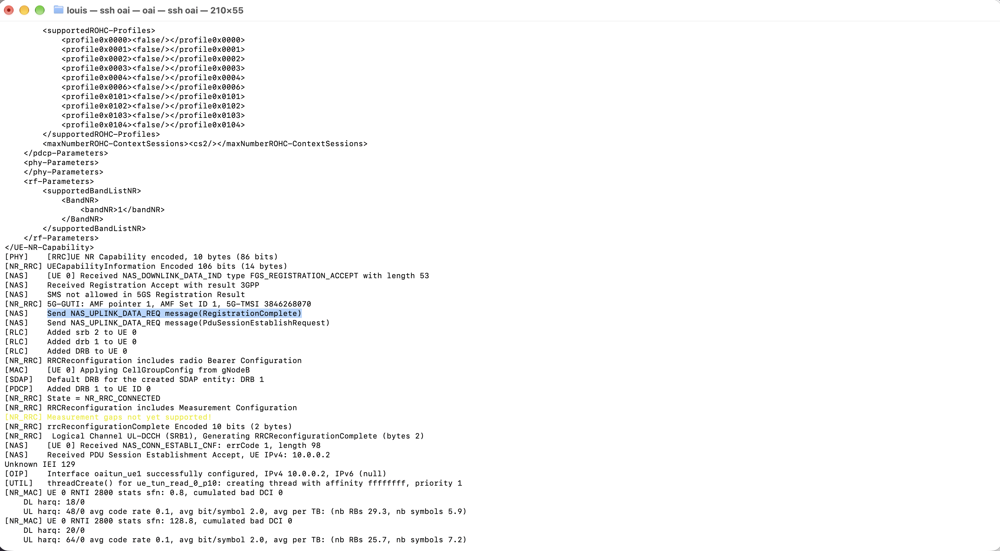*Received Registration Accept with result 3GPP, Send NAS_UPLINK_DATA_REQ message(RegistrationComplete)*|
| PDU Session Establishment | Yes | 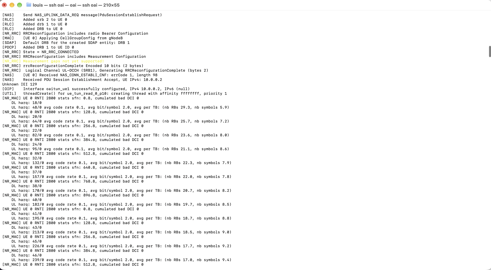*Received PDU Session Establishment Accept, UE IPv4: 10.0.0.2*|
| UE tunnel creation | Yes | 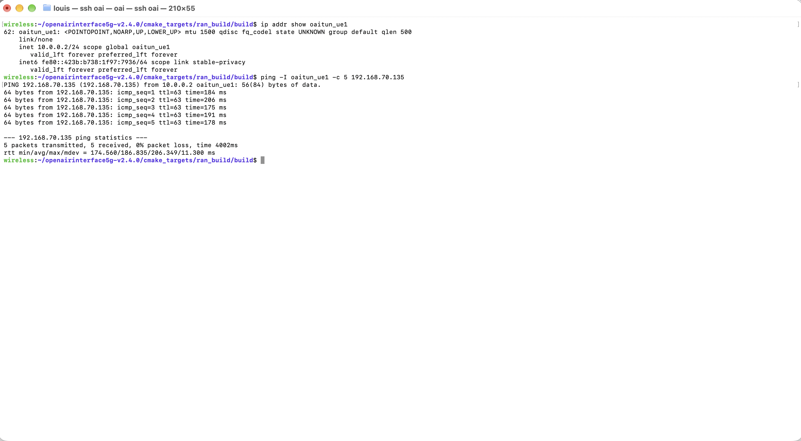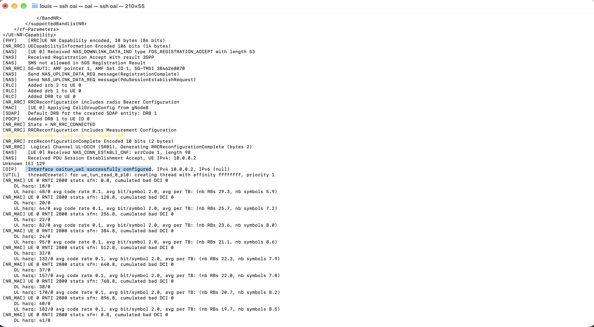|

Take screenshots showing the gNB and UE successfully connected.

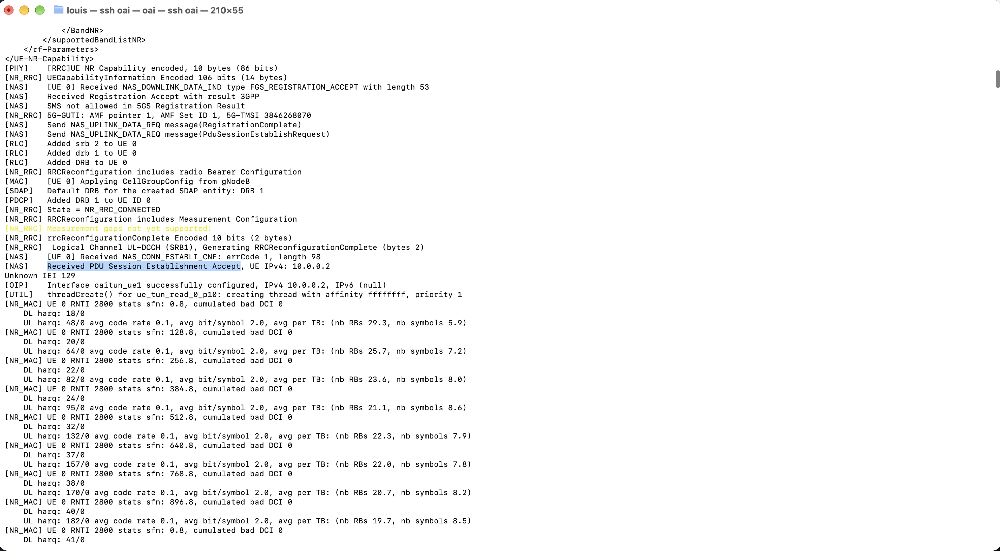
*Evidence 1 — screenshot of gNB and UE successfully connected*


**Questions:**

1. Does a successful NG Setup guarantee that a UE can register? Explain.

   No, because NG Setup only happens between the gNB and the AMF to check parameters like PLMN and TAC without involving a subscriber. Registration requires a provisioned IMSI and successful authentication.

2. Why can the UE establish an RRC connection but still fail Registration?

    Because RRC is only a radio procedure between the UE and the gNB. Registration is a NAS procedure between the UE and the AMF. The AMF can still reject it for an unknown IMSI, failed authentication, or a slice not allowed, even if the radio link works.
3. What additional procedure is required after Registration before user data can be exchanged?

    A PDU Session Establishment is required. The AMF contacts the SMF to configure the UPF, and the gNB sets up the radio bearer and GTP-U tunnel for the UE IP address. Without a PDU session, the UE is registered but has no path for user data.

## 4. Task 2 — Investigate RFsimulator Communication

OAI RFsimulator replaces the physical RF interface with software-based communication.

The gNB and nrUE exchange IQ samples through a TCP connection.

Check the running processes:

```bash
pgrep -a nr-softmodem
pgrep -a nr-uesoftmodem
```

Inspect the TCP connections:

```bash
sudo ss -tnp | grep 4043
```

If necessary, inspect the listener:

```bash
sudo ss -ltnp | grep 4043
```

The default RFsimulator port in this experiment is 4043.

Complete the table:

| Item | Observed Value |
|---|---|
| gNB process ID | 297030 |
| nrUE process ID | 297925 |
| RFsimulator transport protocol | TCP |
| RFsimulator port | 4043 |
| TCP connection state | ESTAB (gNB side listening: LISTEN) |
| Connected process(es) | nr-softmodem (server, pid 297030) and nr-uesoftmodem (client, pid 297925) |

Take one screenshot showing the TCP connection.

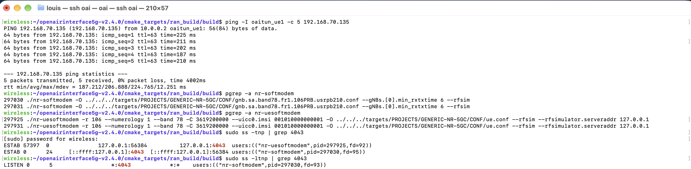
*Evidence 2 — screenshot of the TCP connection*

**Questions:**

1. Why does RFsimulator use a TCP connection instead of a physical antenna?

    RFsimulator replaces the RF hardware with software. The gNB and nrUE exchange IQ samples through a reliable TCP socket to stay synchronized without physical antennas.
2. Are the TCP packets exchanged by RFsimulator the same as the UE's application-layer IP packets?

    No. The TCP connection carries IQ samples for the radio waveform. The UE's IP packets are the user data payload that travels inside those IQ samples.
3. Does using RFsimulator mean that the UE and gNB are performing no physical-layer processing? Explain.

    No. Both still run the full PHY processing. Like we can see in the logs, this shows as PBCH decoding and the RACH procedure. Only the analog RF hardware is replaced by TCP.

## 5. Task 3 — Verify End-to-End Connectivity

Check the UE tunnel interface:

```bash
ip -4 addr show oaitun_ue1
```

Test connectivity to the External DN:

```bash
ping -I oaitun_ue1 -c 10 192.168.70.135
```

Record:

| Measurement | Observed Value |
|---|---|
| UE IP address | 10.0.0.2 |
| Destination IP | 	192.168.70.135 |
| Packets transmitted | 10 |
| Packets received | 10 |
| Packet loss (%) | 0 |
| Minimum RTT (ms) | 173,957 |
| Average RTT (ms) | 190,836 |
| Maximum RTT (ms) | 207,998 |

Take a screenshot of the Ping result.

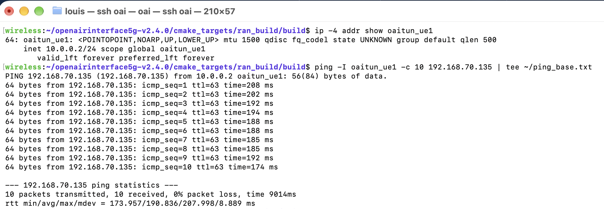
*Evidence 3 — screenshot of the ping result*

**Questions:**

1. Why must Ping use the `oaitun_ue1` interface in this experiment?

    Ping must use the oaitun_ue1 interface to force the packets through the simulated 5G link. Without it, Linux would use the default route and bypass the 5G network entirely.
2. Does successful Registration guarantee successful user-plane connectivity?

    No, because Registration is only a control-plane procedure between the UE and the AMF. User-plane connectivity still requires a PDU session, a data radio bearer, and a GTP-U tunnel, which can fail even if the UE is registered.
3. What does a successful Ping prove, and what does it not prove about the simulated 5G system?

    It proves that the user-plane chain works end to end, with 0% loss in my test. It does not prove real over-the-air performance or real 5G latency because there is no RF hardware and the delay only reflects software processing on a VM.

## 6. Task 4 — Investigate the Effect of Packet Size

You will now investigate whether changing the ICMP packet size affects the observed RTT.

Perform three experiments using the same established 5G connection.

**Scenario A — Small Packets**

```bash
ping -I oaitun_ue1 -s 56 -c 30 -i 0.2 192.168.70.135
```

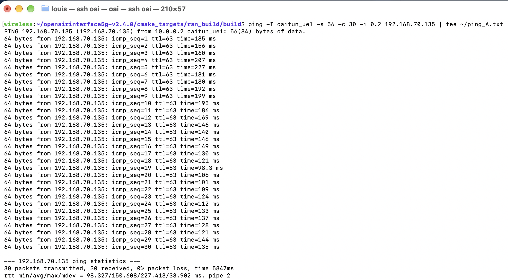
*Evidence 4 — ping result scenario A*


**Scenario B — Medium Packets**

```bash
ping -I oaitun_ue1 -s 512 -c 30 -i 0.2 192.168.70.135
```
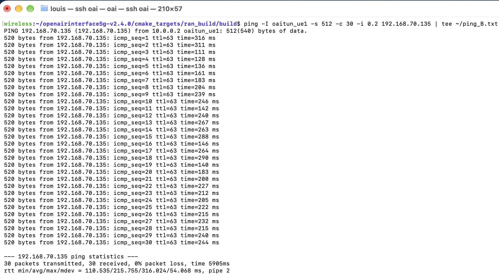
*Evidence 5 — ping result scenario B*

**Scenario C — Large Packets**

```bash
ping -I oaitun_ue1 -s 1200 -c 30 -i 0.2 192.168.70.135
```
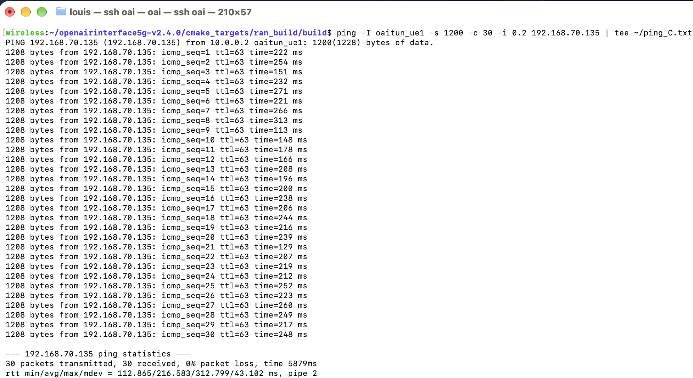
*Evidence 6 — ping result scenario C*

Note: `-s` specifies ICMP payload size, not the complete IP packet size.

Complete the table:

| Scenario | ICMP Payload | Avg. RTT (ms) | Max. RTT (ms) | Packet Loss (%) |
|---|---:|---:|---:|---:|
| A | 56 bytes | 150,608 | 227,413 | 0 |
| B | 512 bytes | 215,755 | 316,024 | 0 |
| C | 1200 bytes | 216.583 | 312,799 | 0 |

Calculate the RTT difference:

```text
RTT Difference = Average RTT(C) - Average RTT(A)
               = 216,583 − 150,608 = 65,975 ms
```

**Questions:**

1. Which scenario has the highest average RTT?

    Scenario C has the highest average RTT with 216,583 ms. But like we can see in the results, Scenario B is practically equal at 215,755 ms, so the only clear difference is between A and the other two.
2. Does increasing packet size always increase RTT in your measurements?

    No. My results show that average RTT rose by 65 ms from A to B, but by under 1 ms from B to C despite having twice the payload. The increase is not proportional to packet size.
3. Why might a larger packet require more transmission or processing resources?

    A larger packet needs more bits to be segmented, coded, and mapped to more resource blocks. This takes more PHY processing, more slots to schedule, and more byte processing at each layer.
4. What factors other than packet size could affect RTT in a software-based 5G network?

    The CPU load of the emulated VM, the TDD slot pattern, and the timing of real-time threads. This explains the large RTT spread and the drift I measured.
5. Can these results be interpreted as real over-the-air 5G latency? Explain.

    No. There is no real RF hardware and the radio samples travel through a TCP socket. The RTT of 150 to 217 ms is dominated by software processing on the VM, so it cannot be interpreted as real 5G latency.

Do not assume that RTT must increase with packet size. Use your measured values to support your explanation.

## 7. Task 5 — Diagnose a Controlled UE Registration Failure

In this task, you will deliberately introduce one configuration error and investigate why the UE cannot complete registration.

**Important:** Save the original successful UE command before starting. Do not modify the CN5G subscriber database.

### Step 1 — Stop the UE

Press `Ctrl+C` in the nrUE terminal. Keep the CN5G and gNB running.

### Step 2 — Launch the UE with an Incorrect IMSI

Change only the IMSI:

```bash
sudo ./nr-uesoftmodem \
  -r 106 \
  --numerology 1 \
  --band 78 \
  -C 3619200000 \
  --uicc0.imsi 001010000000099 \
  --rfsim \
  --rfsimulator.serveraddr 127.0.0.1
```

The IMSI `001010000000099` is not provisioned in the standard classroom subscriber configuration. Verify this assumption against the instructor's database before class.

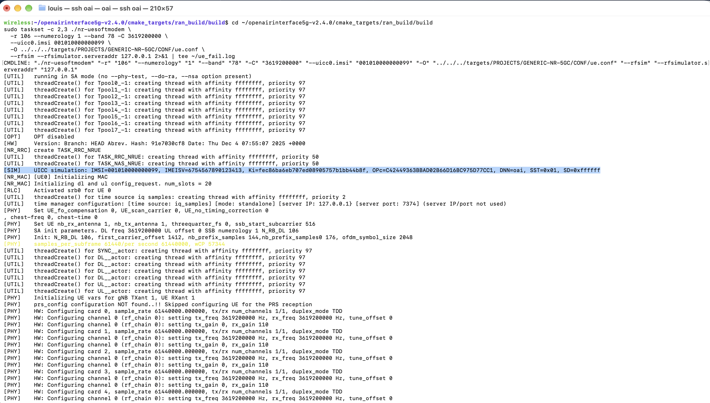
*Evidence 7 —  Launching the UE with an Incorrect IMSI*

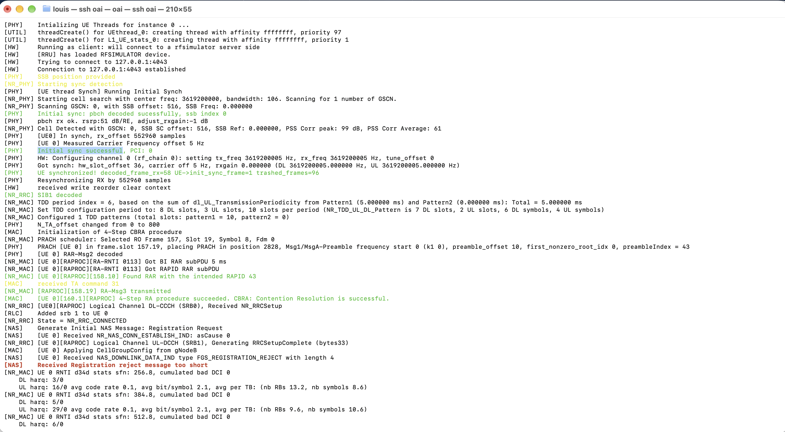
*Evidence 8 —  UE synchronized with gNB, RRC connection established and registration rejected*

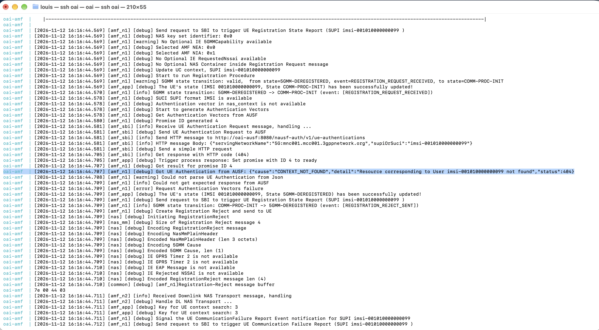
*Evidence 9 —  Likely cause fof the error*

Observe the UE and AMF logs.

```bash
cd ~/oai-cn5g
docker compose logs --since=2m oai-amf
```

Allow time for registration attempts, then stop the UE.

Complete the table:

| Item | Observation |
|---|---|
| Modified parameter | IMSI 001010000000001 → 001010000000099 |
| UE synchronized with gNB? | Yes |
| RRC connection established? | Yes |
| Registration successful? | No |
| Error or rejection evidence | [NAS]    Received Registration reject message too short|
| Likely cause | The new IMSI value is not in the DB, making the authentication impossible|

If the expected registration rejection does not appear, report the actual logs instead of inventing a failure message.

### Step 3 — Restore the Original IMSI

Restart the nrUE using:

```text
--uicc0.imsi 001010000000001
```

Confirm that the UE successfully registers again and that Ping works.


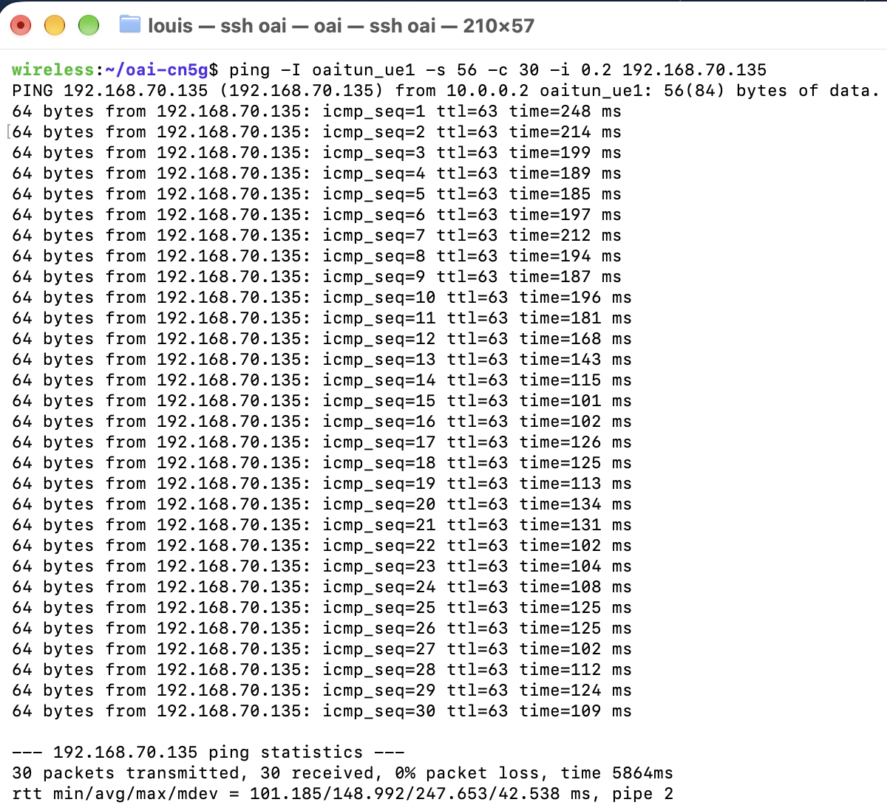
*Evidence 10 —  UE successfully registers with original IMSI*

**Questions:**

1. Why can the UE potentially synchronize with the gNB even when the IMSI is incorrect?

    Synchronization is only a physical-layer procedure. The gNB broadcasts the SSB and SIB1 to every UE, and the IMSI is only used later in NAS messages. Like we can see in my setup, the UE synchronized and reached RRC_CONNECTED before being rejected.
2. Which network function is involved in UE authentication?

    The AUSF runs the authentication procedure and relies on the UDM to retrieve subscriber credentials. If the subscriber is not found, no authentication vector is produced and the AMF rejects the registration.
3. Why does changing an IMSI affect Registration but not the RFsimulator TCP connection itself?

    The TCP connection only carries IQ samples for the simulated radio link and is established before any NAS messages. The IMSI is only checked by the core network during registration, so a wrong IMSI breaks the NAS procedure but leaves the TCP connection working.
4. What evidence proves that restoring the correct configuration solved the problem?

    My logs show that after restoring the correct IMSI, the UE received a Registration Accept and a PDU Session Establishment Accept. The oaitun_ue1 interface is successfully configured with an IP address, and the ping gets 0% loss, proving the IMSI was the only issue.

Submit evidence from both the failed and recovered connections.


## 8. Task 7 — Explain the Relationship Between Simulation and Real 5G

Your OAI gNB and nrUE perform 5G NR protocol processing even though they do not use physical antennas.

Complete the comparison:

| Feature | OAI RFsimulator | Physical 5G System |
|---|---|---|
| gNB and UE protocol stack | Yes | Yes |
| OFDM signal processing | Yes | Yes |
| Physical antennas | No | Yes |
| RF hardware impairments | Not inherently | Yes|
| Wireless propagation effects | Not inherently | Yes|
| 5G Core connectivity | Yes | Yes |

**Questions:**

1. Which parts of the 5G system remain functional when physical RF hardware is replaced with RFsimulator?

    The NR protocol processing of the gNB and nrUE, the OFDM signal processing, and the 5G Core connectivity all remain functional. Only the radio front end is replaced by a TCP connection carrying IQ samples. Like we can see in my test, this is confirmed by the synchronization, the registration, the oaitun_ue1 interface, and the ping with 0% loss.
2. Why is RFsimulator useful for testing the 5G protocol stack?

    RFsimulator is useful because it runs the core, gNB, and nrUE on one machine without radio hardware or spectrum licenses. Tests are repeatable and we can introduce failures on purpose, like with the invalid IMSI. It gives a working baseline to validate signaling and core integration before moving to real hardware.
3. Why might latency and throughput differ between RFsimulator and a real 5G deployment?

    Latency and throughput differ because IQ samples are processed in software and exchanged through a TCP socket with no real radio channel. My results show an RTT of 150 to 217 ms, which is dominated by software scheduling on an emulated VM rather than air-interface delay. A real deployment depends on the radio channel and interference.
4. What would need to change if you wanted to test a physical UE instead of OAI nrUE?
    
    To test a physical UE, the gNB would need to run with real RF hardware instead of RFsimulator. The physical UE's SIM would need its IMSI and keys provisioned in the core database. The network settings like band, PLMN, and slice would also have to match what the UE supports, and the transmission must be in a legal or shielded setup.

## 9. Final Analysis

Answer each question in three to five sentences.

1. Describe the complete process from starting the OAI 5GC to successful user-plane connectivity.

    The startup progresses by starting the healthy CN5G containers, then the gNB connects to the AMF to complete NG Setup. The nrUE connects to the RFsimulator, synchronizes, establishes the RRC connection, and registers with the AMF. Finally, the PDU session creates the oaitun_ue1 interface, and like we can see in my test, a ping through it gets 10/10 replies.
2. Explain the difference between an RFsimulator TCP connection and a 5G PDU Session.

    The RFsimulator TCP connection replaces the radio link to carry IQ samples and exists before any 5G signaling. A PDU session is created after registration by NAS signaling to provide the UE IP address and the GTP-U path. The TCP link can be up without a PDU session, but it is the PDU session that carries the application traffic, not the TCP link.
3. Based on your measurements, how did packet size affect RTT and packet loss?

    Packet loss was 0% in all scenarios. My results show an average RTT of 150.608 ms for 56 bytes, 215.755 ms for 512 bytes, and 216.583 ms for 1200 bytes. Scenarios B and C are almost identical even though the payload doubled. Because the standard deviations are high, packet size does not clearly explain the RTT increase, and software scheduling on the VM probably contributed.
4. Describe the registration failure you introduced and explain how you diagnosed and recovered from it.

    I checked that the wrong IMSI was not in the database and restarted the UE. The UE synchronized and reached RRC connected but received no Registration Accept. Like we can see in the AMF logs, the cause was the missing subscription. I restored the correct IMSI and confirmed the fix with a successful ping on oaitun_ue1.
5. Identify two limitations of this simulated environment and explain how they might affect experimental results.

    The first limitation is that there is no real radio channel, meaning no interference or hardware impairments, making loss and retransmissions unrealistically good. The second limitation is that performance depends entirely on the CPU of the emulated VM. This makes the RTT high and variable, so it cannot predict real 5G latency or reliability.

## 10. Submission Checklist

Submit one Markdown or PDF report containing:

- Completed 5G SA connection verification table.
- gNB and nrUE connection screenshots.
- RFsimulator TCP connection evidence.
- Baseline Ping measurement.
- Three packet-size comparison results.
- RTT difference calculation.
- Controlled failure and recovery evidence.
- RFsimulator versus physical 5G comparison.
- Answers to the final analysis questions.

All measurements and log evidence must come from your own experimental environment.

## 11. Grading Rubric

| Item | Points |
|---|---:|
| Complete 5G SA deployment | 15 |
| RFsimulator TCP connection analysis | 15 |
| End-to-end user-plane verification | 15 |
| Packet-size experiment and analysis | 20 |
| Controlled failure and recovery | 20 |
| Simulation limitations and final analysis | 15 |
| **Total** | **100** |

Vote TOP3：https://forms.gle/Mvza68DFBzPcZXfW6